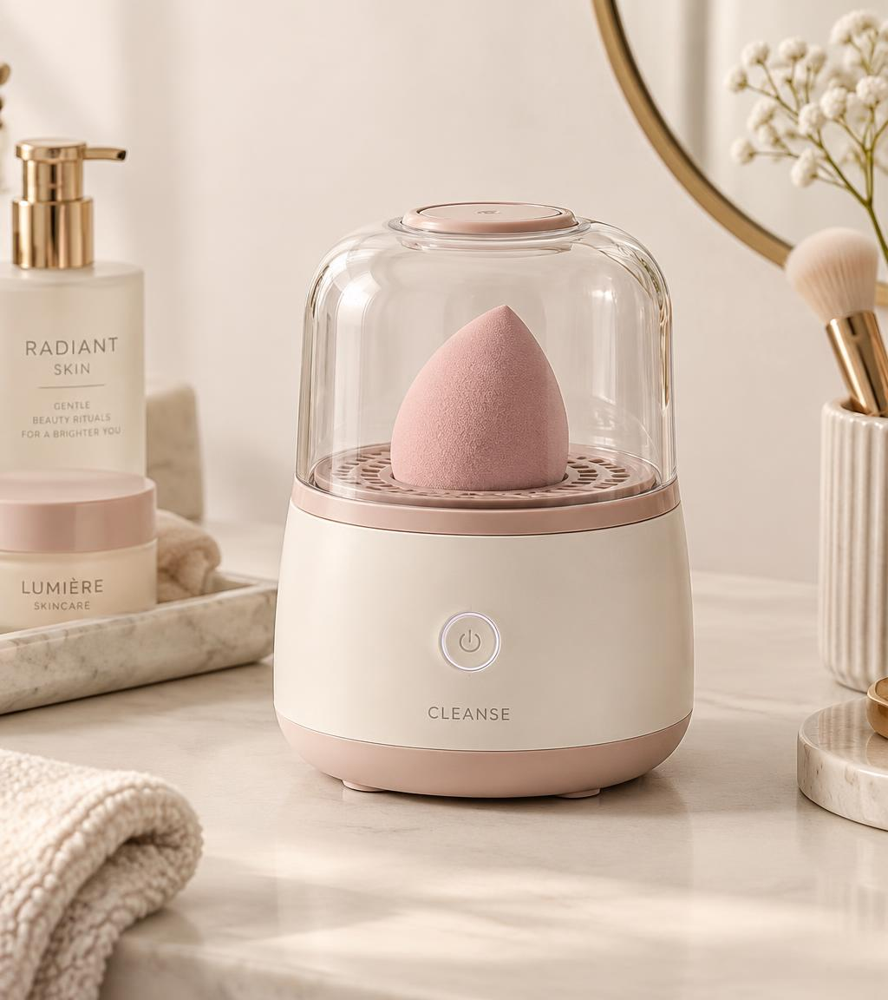

# BlendPure · Estación inteligente de cuidado de belleza

> **Tu esponja limpia. Tu rutina más simple.**
> Sitio web comercial y académico de BlendPure, una propuesta de dispositivo *beauty-tech* que integra **limpieza, enjuague, desinfección UV-C y secado** de esponjas de maquillaje en un solo ciclo.



**Proyecto académico** · Pontificia Universidad Javeriana · Mercadeo en Internet · 2026
**Equipo:** Manuela Granados · Danna Sáenz · Isabela Carmona · Laura Quiñones

🔗 **Demo:** `https://<tu-usuario>.github.io/<nombre-del-repo>/` *(reemplaza con tu enlace después de activar GitHub Pages)*

---

## Sobre el proyecto

BlendPure parte de una pregunta de investigación:

> ¿Existe, entre las mujeres jóvenes adultas usuarias de maquillaje de cobertura en Bogotá, una fricción de tiempo y esfuerzo en la limpieza manual de sus esponjas lo suficientemente relevante como para justificar una estación automática de limpieza, desinfección y secado como BlendPure?

La web funciona al mismo tiempo como **landing de marca premium** y como **presentación de la investigación**: integra el análisis de mercado, la competencia, la encuesta primaria, las entrevistas a especialistas, el marco teórico y la estrategia de marketing digital.

### Hallazgos principales

| Hallazgo | Dato | Fuente |
|---|---|---|
| La limpieza es poco frecuente | **68 %** limpia su esponja una vez al mes o menos | Encuesta propia (n = 147) |
| El problema es la fricción | **87,7 %** señala olvido, pereza o el tiempo del proceso | Encuesta propia (n = 147) |
| El concepto interesa | **95,2 %** le ve algún grado de utilidad | Encuesta propia (n = 147) |
| El precio no está validado | Solo **25,2 %** pagaría COP 250.000–450.000 (meta: ≥ 50 %) | Encuesta propia (n = 147) |
| La decisión de compra depende del video | **81 %** decide por reseñas de creadoras y demos en video | Encuesta propia (n = 147) |
| Mercado de referencia (TAM) | **USD 351,72 M**: cosméticos y maquillaje en Colombia, 2025 | Mordor Intelligence (2026) |
| Mercado potencial (SAM) | **≈ 512.975** consumidoras potenciales en Bogotá | Cálculo propio con supuestos del documento |

**Conclusión:** el problema está respaldado por la evidencia, pero el precio todavía no.

> ⚠️ La encuesta es exploratoria: se aplicó a una muestra por conveniencia de universitarias y no es representativa del segmento objetivo. Las entrevistas son evidencia cualitativa.

---

## Secciones del sitio

| # | Sección | Contenido |
|---|---|---|
| 1 | **Inicio** | Hero editorial, las 4 etapas y el precio de referencia (COP $349.900, precio propuesto) |
| 2 | **Producto** | Ficha del producto, beneficios y botón "Agregar a la bolsa" |
| 3 | **Cómo funciona** | Las cuatro etapas: limpieza, enjuague, desinfección UV-C y secado con aire frío |
| 4 | **Problema** | Cifras secundarias, cadena del problema y pregunta de investigación |
| 5 | **Propuesta de valor** | Tres pilares: ahorro de tiempo, simplicidad y cuidado de la herramienta |
| 6 | **Mercado** | CAGR de belleza, maquillaje, beauty-tech y canal online; embudo TAM/SAM/SOM; buyer persona |
| 7 | **Competencia** | Tabla comparativa, costo de sustitutos y casos de éxito y fracaso |
| 8 | **Investigación** | Resultados de la encuesta en gráficos interactivos y estado de los objetivos |
| 9 | **Entrevistas** | Citas de especialistas e implicaciones de negocio |
| 10 | **Marco teórico** | 8 conceptos (Rogers, Ajzen, STP, VPC, CRM, omnicanalidad, customer journey, CLV) y su contraste con los datos |
| 11 | **Marketing digital** | Customer journey, canales, Refill Club, métricas y mensajes |
| 12 | **Conclusiones** | Cierre del proyecto |
| 13 | **Bolsa de compra** | Carrito simulado (no procesa pagos) |

---

## Tecnologías

- **HTML5** semántico
- **CSS3**: variables, Grid, Flexbox, `clamp()`, animaciones y diseño *responsive*
- **JavaScript** puro, sin librerías ni frameworks
- **Google Fonts**: Cormorant Garamond (titulares) y DM Sans (texto)

### Funcionalidades

- Menú *sticky* con navegación por anclas, resaltado de la sección activa y menú móvil
- Barra de progreso de lectura
- Contadores animados y aparición progresiva de las secciones (`IntersectionObserver`)
- Gráficos de barras generados con JavaScript a partir de los datos de la encuesta
- Pestañas, carrusel de citas y tarjetas del marco teórico que se voltean, con filtros
- Bolsa de compra simulada con panel lateral y persistencia en `localStorage`
- Accesibilidad: roles ARIA, foco visible, enlace para saltar al contenido y soporte de `prefers-reduced-motion`

---

## Estructura del repositorio

```
blendpure-web/
├── index.html                     # Página principal
├── style.css                      # Estilos (paleta, layout, responsive)
├── script.js                      # Interacciones, gráficos y bolsa de compra
├── img/
│   ├── hero-product.jpg           # Fotografía principal del producto
│   └── blendpure-render.jpg       # Render conceptual
├── BlendPure_Presentacion_v4.pptx # Presentación del proyecto
└── README.md
```

---

## Cómo verlo

**En local:** descarga o clona el repositorio y abre `index.html` en el navegador. No necesita instalación.

```bash
git clone https://github.com/<tu-usuario>/<nombre-del-repo>.git
cd <nombre-del-repo>
# Abre index.html, o levanta un servidor local:
python3 -m http.server 8000   # luego visita http://localhost:8000
```

**Publicarlo con GitHub Pages:**

1. Sube los archivos al repositorio. `index.html` debe quedar en la raíz.
2. Ve a **Settings → Pages**.
3. En **Source**, elige **Deploy from a branch**, rama `main` y carpeta `/ (root)`.
4. Guarda. En uno o dos minutos el sitio estará en `https://<tu-usuario>.github.io/<nombre-del-repo>/`.

---

## Paleta de colores

| Color | Hex | Uso |
|---|---|---|
| Marfil | `#FAF7F3` | Fondo principal |
| Blanco | `#FFFFFF` | Tarjetas |
| Rosa empolvado | `#E8D3D4` | Elementos destacados |
| Rosa nude | `#D8B7B7` | Detalles y gráficos |
| Beige arena | `#E9DFD4` | Fondos de sección |
| Malva grisáceo | `#725D64` | Botones e iconos |
| Café rosado oscuro | `#514148` | Bloques oscuros |
| Texto principal | `#30282C` | Texto |
| Texto secundario | `#766B6D` | Texto de apoyo |

---

## Aviso

BlendPure es una **propuesta universitaria y un prototipo conceptual**. No está fabricado, certificado ni disponible para la venta, y la bolsa de compra es una simulación que no procesa pagos. El sitio no hace afirmaciones sanitarias: la eficacia de la desinfección UV-C, los tiempos del ciclo y la compatibilidad con materiales deben sustentarse en pruebas documentadas.

Las marcas de terceros (Beautyblender, STYLPRO, Dyson, Foreo, Juicero, Clarisonic, Color&Co) se mencionan solo con fines de análisis competitivo.

## Fuentes

**Secundarias:** Beautyblender (2025); Salon Services (s.f.); Bashir y Lambert, Aston University, en EMJ Reviews (2020); Verified Market Research (2025); DataInsightsMarket (2026); Mordor Intelligence (2026); Research and Markets (2026); DANE vía Telencuestas (2025); PCM Agencia (2025); Accenture y TikTok, en El Colombiano (2024); Forbes (2021, 2022); Fortune (2017); WWD (2020); Business of Business (2020); Stylideas (s.f.); Boots (s.f.).

**Marco teórico:** Rogers (1962); Ajzen (1991); Kotler y Armstrong (2018); Osterwalder, Pigneur, Bernarda y Smith (2014); Payne y Frow (2005); Verhoef, Kannan e Inman (2015); Lemon y Verhoef (2016); Gupta y Lehmann (2003).

**Primarias:** encuesta exploratoria (n = 147) y entrevistas semiestructuradas a especialistas. Elaboración propia, Grupo BlendPure (2026).

La bibliografía completa está en el documento del proyecto y en la [presentación](BlendPure_Presentacion_v4.pptx).
